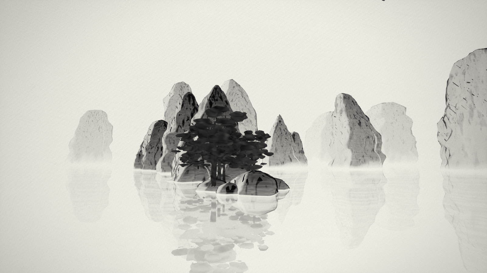

# PianoUE5
A piano game created with Unreal Engine 5 for piano teaching. This piano can play any piece based on the key information from MIDI files, including dynamics, duration, and more.

## Tech Stack
1. Unreal Engine 5
2. C++
3. Python

## Usage
1. clone the repo
2. install the [Dependencies](#dependencies)
3. open ```Piano_v2.uproject``` with Unreal Engine 5.8 (the C++ module is built on first open), or [package the project](#package-project) and run ```Piano_v2.exe```

## Dependencies
1. Unreal Engine 5.8
2. Visual Studio 2022 (17.14+) or Visual Studio 2026, with the ```Game development with C++``` workload, to build the C++ module
3. ```mido``` and ```numpy```, installed into the Python that ships with the engine:
```
"C:\Program Files\Epic Games\UE_5.8\Engine\Binaries\ThirdParty\Python3\Win64\python.exe" -m pip install mido numpy
```
##### Note: ```convert.py``` runs on the engine's bundled Python, both in the editor and in packaged builds, so the packages must be installed there rather than in a system Python.

## Design
### Load MIDI File

##### Here, the MIDI file will be parsed by ```convert.py```, and then be read by UE5.

### Play Sound


### Press Key Animation


### Play / Pause Songs


### Switch Songs


### Select Songs From File Manager


## Ink Wash Mode
The default level, ```Content/InkWash/Maps/Piano_Scene_Ink```, is a three-dimensional ink wash painting of a river among karst peaks, on white xuan paper. The piano stands on the water, and its music paints the landscape around it:


1. **The piano**: the grand piano keeps its own realistic materials and lighting. Everything around it is painted in ink, and the paper shows fibres and grain.
2. **Peaks rising with the song**: karst peaks rise out of the mist all around the river as the song goes on. High notes raise the near cliffs, and low notes raise the distant ranges, measured against the song's own range so that every song paints the whole landscape. A long song sweeps across the river several times, so the landscape appears within the first minute and keeps growing.
3. **A world you can walk into**: the near cliffs, the boulders at their feet and the trees among them are solid. The player can walk across the water up to them, around them and between them.
4. **The inscription**: the melody writes *高山流水* ("high mountains, flowing water", the story of a qin player and the friend who heard the mountains and the river in his music) in the sky over the river. The brush writes real kaishu characters stroke by stroke in stroke order. It is heavy at the start of each stroke and runs dry into flying white (飞白) on long strokes.
5. **The water**: the river is blank paper. Every peak and the piano are mirrored in it, and the reflections break into ripples and fade as they go deeper. As the piano plays, rings run across the water from around its feet.
6. **Finale**: when the song ends, the camera pulls back over the river, any unfinished peaks rise, and a vermilion stone seal with the song's name is stamped on the painting. Moving or looking around gives the view back to the player.




```AInkConductor``` reads the piano blueprint's playback state by reflection, so the piano blueprint is unchanged. The level starts the first song by itself (```bAutoPlayOnStart``` on the ```InkConductor``` actor), and the usual keys still work. The original level is still at ```Content/GrandPiano/Maps/Piano_Scene```.

Console commands (open the console with ```~```):

| Command | Effect |
|---|---|
| ```ink.Song <index or name>``` | load a song from ```Content/MIDI``` by its index in the song list or part of its name, e.g. ```ink.Song 13``` |
| ```ink.Grow``` | raise every peak to its full height now |
| ```ink.Finale``` | pull back and stamp the seal now |
| ```ink.Reset``` | wipe the painting |

##### The song title and the seal use the [Ma Shan Zheng](https://github.com/googlefonts/mashanzheng) brush font, licensed under the SIL Open Font License (```Content/InkWash/Fonts/MaShanZheng-OFL.txt```). The strokes of the inscription come from [Hanzi Writer](https://github.com/chanind/hanzi-writer-data) / [Make Me a Hanzi](https://github.com/skishore/makemeahanzi), derived from fonts by Arphic Technology under the Arphic Public License (```Source/Piano_v2/InkGlyphs-ARPHICPL.txt```).

## Package Project

##### The packaged build includes the engine's Python (with ```mido``` and ```numpy```) through the ```Python3``` module dependency, and ```convert.py``` and ```Content/MIDI``` through ```RuntimeDependencies``` in ```Piano_v2.Build.cs```, so no files need to be copied by hand after packaging.

## Demo Screenshots

