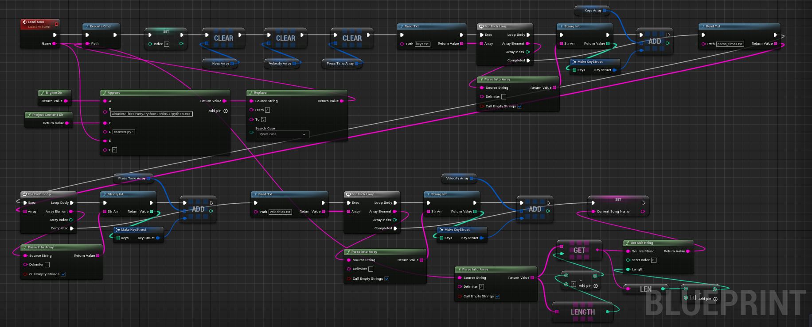
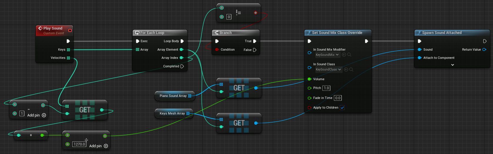
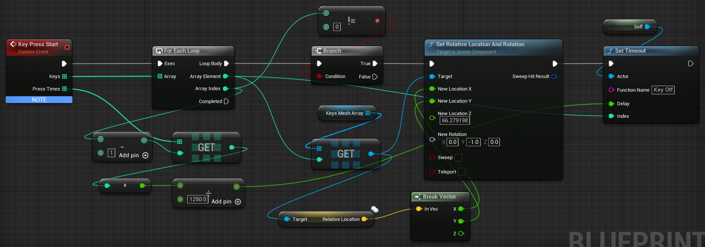
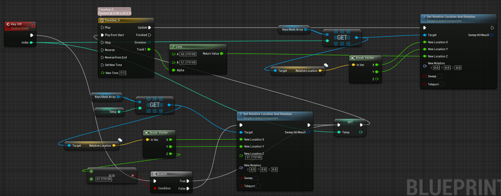
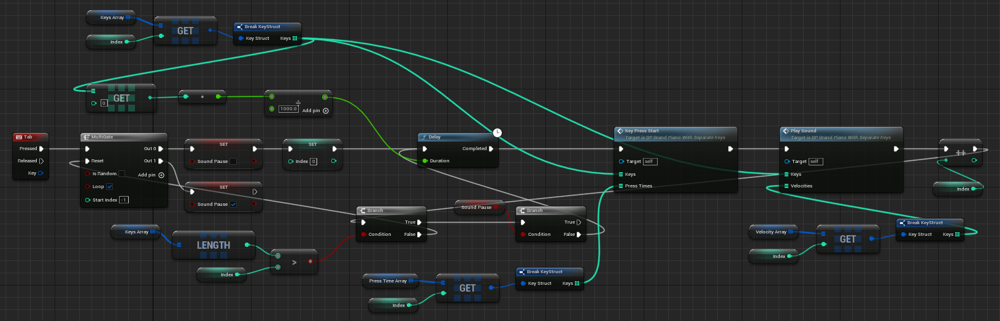
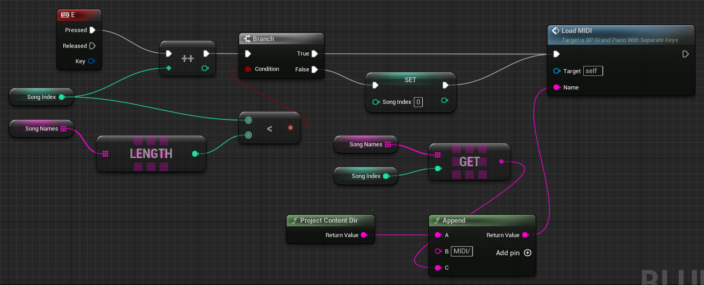
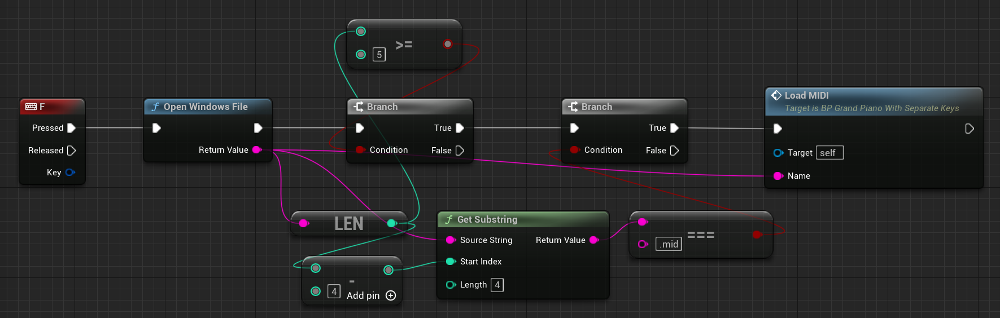
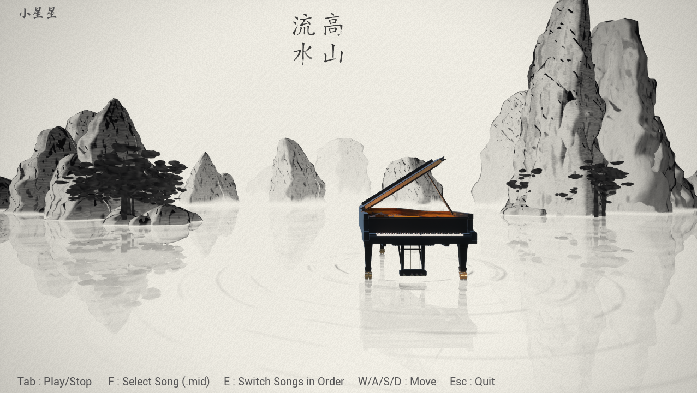
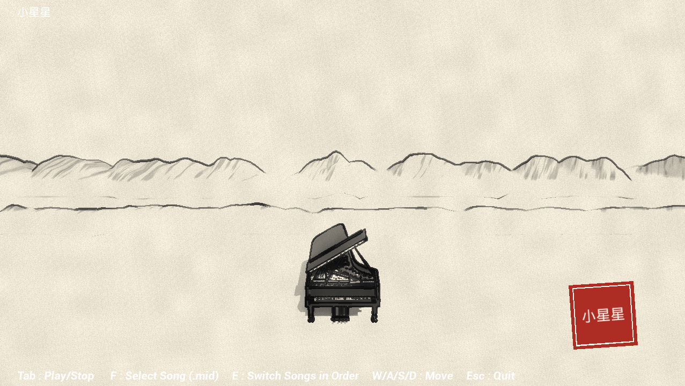
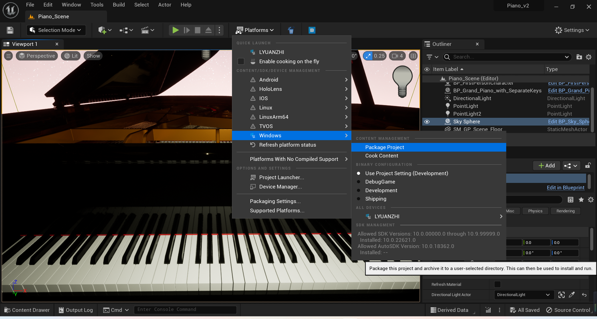

# PianoUE5
A piano game created with Unreal Engine 5 for piano teaching. This piano can play any piece based on the key information from MIDI files, including dynamics, duration, and more.

## Tech Stack
1. Unreal Engine 5
2. C++
3. Python

## Usage
1. clone the repo
2. install the [Dependencies](#dependencies)
3. open ```Piano_v2.uproject``` with Unreal Engine 5.8 (the C++ module is built on first open), or [package the project](#package-project) and run ```Piano_v2.exe```

## Dependencies
1. Unreal Engine 5.8
2. Visual Studio 2022 (17.14+) or Visual Studio 2026, with the ```Game development with C++``` workload, to build the C++ module
3. ```mido``` and ```numpy```, installed into the Python that ships with the engine:
```
"C:\Program Files\Epic Games\UE_5.8\Engine\Binaries\ThirdParty\Python3\Win64\python.exe" -m pip install mido numpy
```
##### Note: ```convert.py``` runs on the engine's bundled Python, both in the editor and in packaged builds, so the packages must be installed there rather than in a system Python.

## Design
### Load MIDI File

##### Here, the MIDI file will be parsed by ```convert.py```, and then be read by UE5.

### Play Sound


### Press Key Animation



### Play / Pause Songs


### Switch Songs


### Select Songs From File Manager


## Ink Wash Mode
The default level, ```Content/InkWash/Maps/Piano_Scene_Ink```, renders the scene as a three-dimensional ink wash painting on white xuan paper, and the piano paints it as it plays:



1. **Ink wash rendering**: a post process draws brush outlines from scene depth, reduces the colours to a few tones of ink, and lets the distant ground fade into blank paper (留白).
2. **Ink drops**: every note flicks a drop of ink off its key. The drop is released early so that it hits the paper on the same frame the note sounds, then spreads into a stain. Strong notes also raise a cloud of ink.
3. **Calligraphy in the air**: the melody is written behind the piano. The brush rises and falls with the top note and presses harder on louder notes, and its trail dries out into flying white (飞白).
4. **Landscape scroll**: mountains grow from left to right as the song goes on. Low notes build the far range and high notes build the near hills.
5. **Finale**: when the song ends, the camera pulls back over the whole painting and a vermilion seal with the song's name is stamped on it.



```AInkConductor``` reads the piano blueprint's playback state by reflection, so the piano blueprint is unchanged. The level starts the first song by itself (```bAutoPlayOnStart``` on the ```InkConductor``` actor), and the usual keys still work. The original level is still at ```Content/GrandPiano/Maps/Piano_Scene```.

Console commands (open the console with ```~```):

| Command | Effect |
|---|---|
| ```ink.Song <index or name>``` | load a song from ```Content/MIDI``` by its index in the song list or part of its name, e.g. ```ink.Song 13``` |
| ```ink.Finale``` | pull back and stamp the seal now |
| ```ink.Reset``` | wipe the painting |

## Package Project

##### The packaged build includes the engine's Python (with ```mido``` and ```numpy```) through the ```Python3``` module dependency, and ```convert.py``` and ```Content/MIDI``` through ```RuntimeDependencies``` in ```Piano_v2.Build.cs```, so no files need to be copied by hand after packaging.

## Demo Screenshots

